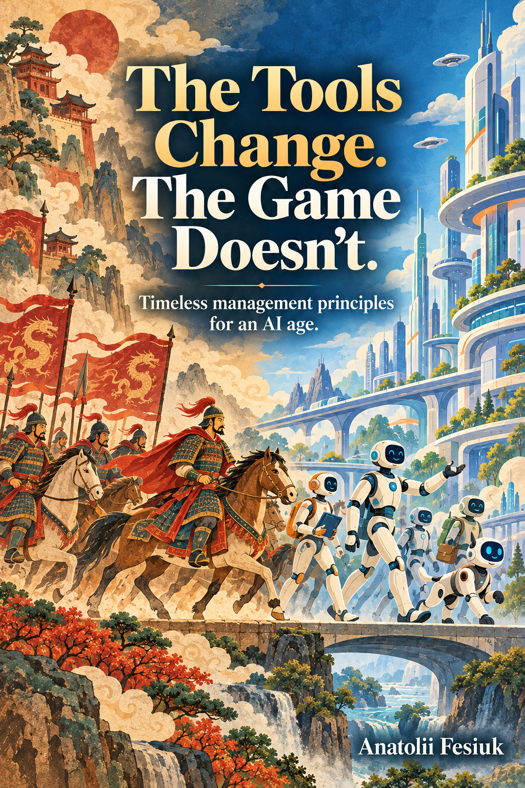

# The Tools Change. The Game Doesn't.

**Timeless management principles for an AI age.**

AI is changing how teams work. Does that mean you need to rethink everything you know about leading them? When the tools change this quickly, it can be hard to see which principles still hold.

*The Tools Change. The Game Doesn't.* explores ideas from Sun Tzu's *The Art of War* and how they apply to teams working with AI today. The book's central idea is that AI is a tool: it changes how we play, but it does not rewrite the rules of the game. Principles that guided strategy centuries ago remain relevant today.

The aim is to help you approach new tools with clearer judgment, so you can plan your team's work around enduring principles as the technology changes.

## A book written in the open

This is an open-source book in progress. Every new addition is publicly visible here as soon as I publish it. You can read along, discuss the chapters, and share your ideas as the book develops.

## Discuss the book with AI

Copy this prompt into the AI assistant of your choice:

> Hey, let's discuss this book: https://github.com/festoinc/the-game

Use it to explore the arguments, question the ideas, and discuss how they apply to your own team. If your assistant cannot access the repository, paste the chapter text into the conversation too.

## Chapters

- [Chapter 1. Planning](01_planning.md) — coming soon.

## License

© 2026 Anatolii Fesiuk. This book is licensed under [Creative Commons Attribution 4.0 International (CC BY 4.0)](LICENSE).

You are free to share, adapt, translate, and use it commercially. Credit Anatolii Fesiuk as the original author, link to [this repository](https://github.com/festoinc/the-game) and [the license](https://creativecommons.org/licenses/by/4.0/), and indicate any changes you make.
